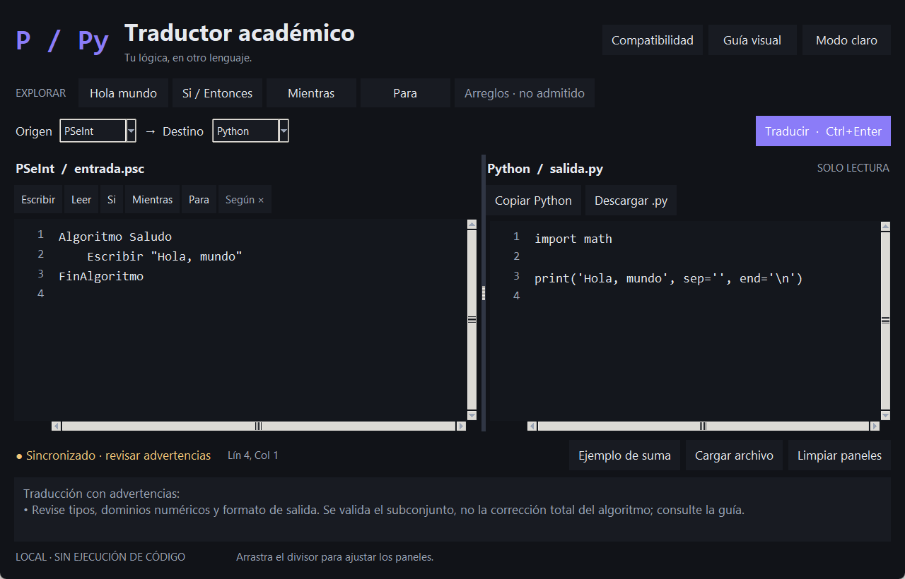
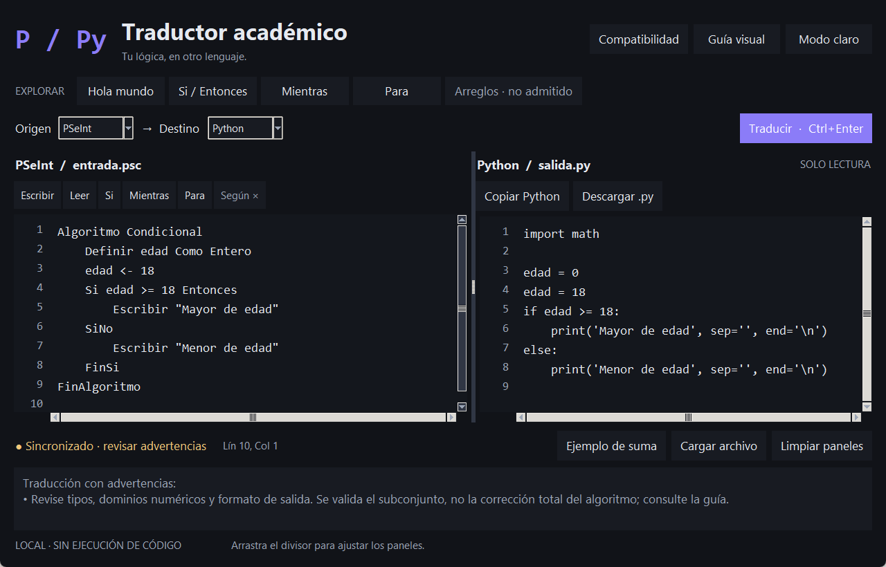
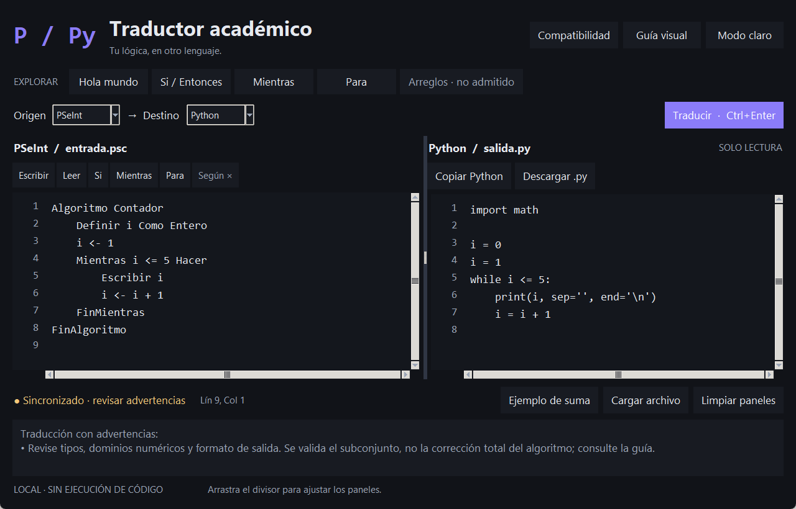

# Evidencias verificadas

Los tres casos se generaron con scripts/generar_evidencias.py --capturas. El script llama al motor original, verifica la sintaxis de Python, ejecuta únicamente fixtures constantes del proyecto y compara la salida exacta con un resultado esperado. Después carga la misma entrada en la interfaz, comprueba que el resultado coincide y captura la ventana. La fecha, versión de Python y plataforma se registran en evidencias/resumen.json.

## Caso 1. Salida de texto

La plantilla Hola mundo utiliza Escribir. Se espera una sola línea: «Hola, mundo». La salida observada coincide, incluido el salto de línea. Este caso comprueba la conservación de la cadena y la emisión de salida.

[Entrada](evidencias/01_saludo/entrada.psc) · [Python](evidencias/01_saludo/traducido.py) · [Resultado](evidencias/01_saludo/resultado.json)

## Caso 2. Condicional

La plantilla Si / Entonces declara edad como entero, asigna 18 y evalúa edad >= 18. Se espera «Mayor de edad» y se obtiene esa línea. Este caso verifica la rama verdadera y la estructura de la traducción if/else. Por sí solo no cubre todos los valores límite ni la rama alternativa.

[Entrada](evidencias/02_condicional/entrada.psc) · [Python](evidencias/02_condicional/traducido.py) · [Resultado](evidencias/02_condicional/resultado.json)

## Caso 3. Ciclo Mientras

La plantilla comienza en i = 1, comprueba i <= 5 y aumenta i en cada vuelta. Se esperan cinco líneas con los valores de 1 a 5 y se obtiene exactamente esa salida. Este caso verifica condición, cuerpo, incremento y terminación para el ejemplo elegido.

[Entrada](evidencias/03_ciclo_mientras/entrada.psc) · [Python](evidencias/03_ciclo_mientras/traducido.py) · [Resultado](evidencias/03_ciclo_mientras/resultado.json)

## Límites de la evidencia

La interfaz no ejecuta el código introducido por el usuario. La ejecución aquí documentada pertenece al script de validación y está limitada a fixtures propios. Estos tres resultados no certifican todos los programas admitidos ni sustituyen la suite de 98 pruebas. Tampoco prueban la ejecución en el intérprete oficial de PSeInt. Los mensajes de advertencia se conservan en las capturas y en los archivos JSON.
